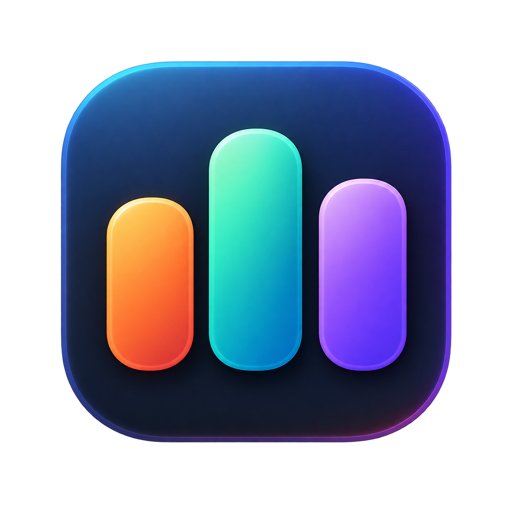
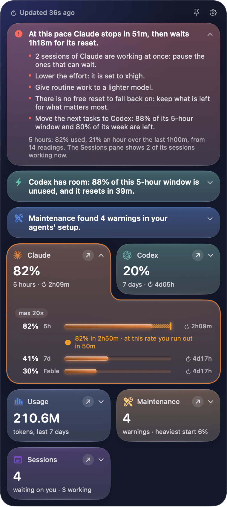

<p align="center">
  
</p>

<h1 align="center">Lancetta</h1>

<p align="center">
  <strong>When and how to use your coding agents, from the macOS menu bar.</strong><br/>
  When to push on with Codex and Claude Code, when to slow down, and which session needs you — without spending a single token to find out.
</p>

<p align="center">
  <a href="https://github.com/gfazioli/lancetta-website/releases/latest"></a>
  <a href="https://www.apple.com/macos/"></a>
  <a href="LICENSE"></a>
</p>

<p align="center">
  <a href="https://lancetta.app">Website</a>
  ·
  <a href="https://lancetta.app/docs">Documentation</a>
  ·
  <a href="https://lancetta.app/docs/roadmap">What's next</a>
</p>

<p align="center">
  
</p>

<div align="center">
  <p><br>
  <sub>Made with <a href="https://github.com/gfazioli/glancecard">glancecard</a> · refreshed daily</sub></p>
</div>

## What is Lancetta?

A *lancetta* is the hand of an instrument — the needle that says where you are, and which way to go. Lancetta is a native macOS menu-bar app that tells you **when and how to use Codex and Claude Code**: push on while a window has room it would lose, slow down before an agent stops (a lower effort, a lighter model for routine work, the other agent while it has room), and trim what every session loads before your first prompt. Each suggestion says what it rests on: the percentage each account reports, how fast it has been moving, when the window resets.

It also keeps your **Claude Code sessions** on one wall, the ones waiting on you first, and closes the background processes the agents leave behind, on your say-so.

It says all this where you already look: the **panel** under the menu-bar item, the **island under the notch**, and a **window** with every suggestion and everything it rests on.

### Reading a quota costs nothing

A monitor that spends quota in order to display quota is self-defeating, and the failure would be invisible — a few hundred tokens per poll, every forty-five seconds, is a real bite out of a five-hour window and nothing in the UI would say so. So it was measured rather than assumed:

| | before | after |
|---|---|---|
| Lifetime tokens | 318,009,023 | 318,009,023 |
| Percentages used | 33% / 13% | 33% / 13% |

Twelve account reads on one connection moved nothing. And the instrument works, which is the half that makes the zero mean something: the same counter moved by **29,188,602** across a day of ordinary use. A counter that *cannot* move looks exactly like a counter that did not.

Claude's numbers come from one account read, made with the sign-in Claude Code keeps on your Mac: the same request Claude Code's own `/usage` makes, with no model in the loop.

**Asking a model how much quota is left is a turn, and it would cost tokens on every poll.** It is the easiest route to build and the one this app will never take.

### An unknown is never a number

The defect that started the project was a status line rendering an unknown as `0%`, and a three-hour-old reading as current. So a window with no reading is drawn as *unknown*, every reading carries the time it was taken, and a source that has fallen behind its own cadence says so — a frozen number is itself an event.

## Status

**Released.** Download the newest build from [lancetta.app/download](https://lancetta.app/download) or this repository's [Releases](https://github.com/gfazioli/lancetta-website/releases) page; later versions arrive through the app's built-in updater. What each version changed is in the [release notes](https://lancetta.app/docs/release-notes), and what comes next is on the [roadmap](https://lancetta.app/docs/roadmap).

## Requirements

- macOS 15 (Sequoia) or later
- Codex, Claude Code, or both. Lancetta finds them itself — a GUI app on macOS inherits almost no `PATH`, so it looks in the places these tools actually install to rather than assuming a shell.
- The notch panel needs a Mac that has a notch. On every other Mac the island never appears and the menu-bar item behaves identically.

## Documentation

Full documentation, screenshots and FAQ at **[lancetta.app](https://lancetta.app)**.

## Trademarks

The Codex and Claude marks shown in the app are the vendors' own artwork, used **nominatively** — to name the products Lancetta reads. Lancetta is not affiliated with, or endorsed by, OpenAI or Anthropic, and one switch in Settings replaces the whole menu with neutral system symbols.

---

## About this repository

This repo hosts the **marketing site**, the **documentation** and, once there is one, the **release download** for Lancetta. The app source lives in a separate, private repository.

It runs the same Next.js 16 + Nextra 4 + Mantine 9 template as [findergit.app](https://findergit.app) and [netfox.app](https://netfox.app); a fix that lands in one is usually a candidate for the others.

```sh
yarn install
yarn dev          # dev server
yarn build        # production build + pagefind index
yarn test         # typegen, format check, lint, typecheck, jest
```

If `yarn <cmd>` answers `command not found: next` / `oxfmt`, the Yarn PATH shim is not wired on this machine — run the binary directly (`./node_modules/.bin/next dev`). `yarn test` and `yarn jest` route through the npm-run shim and work regardless.

### Before the first release

`config.app.released` is `false`, and several things key off it: the hero CTA, the release strip, the Download tab, and the `downloadUrl` / `dateModified` in the JSON-LD. Flip it in the same commit that publishes the first build, and restore the `download` entry in `app/_meta.tsx` and the footer highlight with it.

### Layout

| | |
|---|---|
| `app/` | App Router — homepage, docs route, API routes, sitemap, manifest |
| `components/` | Homepage sections, navbar, footer, release notes, structured data |
| `content/` | The MDX docs, served under `/docs` |
| `config/index.ts` | Everything site-specific: metadata, GitHub repo, app version |
| `theme.ts` | The palette, derived from the app icon |
| `theme/global.css` | Design tokens, including the two agent tints |

### Brand

The palette is the app icon's, **sampled rather than picked** — the bars, the plate and its neon rim were read off the 1254px master with a CoreGraphics probe, and `theme.ts` carries the map. The plate's azure, navy and violet and the rim's cyan and magenta are the page-level tokens in `theme/global.css`; every band and glow on the site is built from them, and the greys are cut on the plate's navy rather than on a neutral.

The brand accent is deliberately the icon's **third** bar. The other two hues already mean *which agent* inside the app — teal is Codex, orange is Claude Code — so the site keeps those semantic and takes its accent from the one the app spends on no agent. An accent borrowed from an agent hue would disagree with every screenshot on the page.

`public/favicon.svg` is a different drawing on purpose: the gradient icon does not survive 16px — measured, its bars get 66 pixels between them and its glow smears the rest — so the tab gets the icon's **flat** variant, redrawn as vector and full bleed. Details in the comment at the top of [`public/favicon.svg`](public/favicon.svg).

## Licence

MIT — see [LICENSE](./LICENSE).
